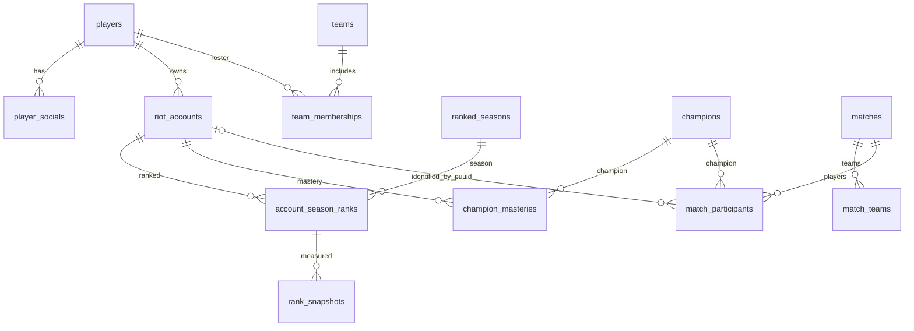
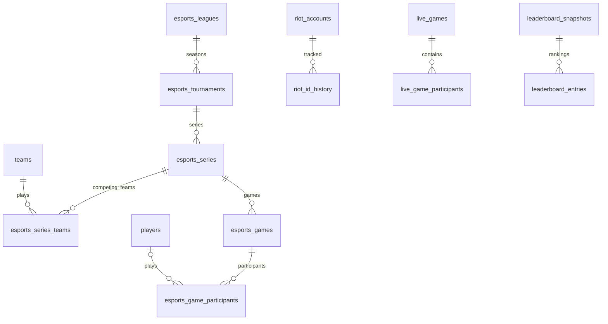

# LoLApp — PostgreSQL 25 tablo / ilişkiler / veri akışı

> Kaynak: `sql/schema.sql` (PostgreSQL 15+). Bu belge açıklayıcıdır, DB şemasını kendisi değiştirmez.

## Mimari özeti

1. **LOLPros JSONL (tek sefer):** `players`, `player_socials`, `riot_accounts`, `ranked_seasons`daki aktif sezonla `account_season_ranks` ve ilk `rank_snapshots`.
2. **Riot API Sync (tekrarlı):** PUUID ve hesap bilgileri; Current/Peak LP; mastery; SoloQ/Flex maç verileri; canlı maç; leaderboard snapshot.
3. **Harici espor verisi (sonra):** `teams`, `team_memberships`, `esports_*` tabloları; **LOLPros HTML importer takımları doldurmaz**.
4. **Kimlik:** `players.id` kişiyi; `riot_accounts.id` hesap satırını; `riot_accounts.puuid` Riot hesabının kalıcı ID’sini tanımlar. `lolpros_id` kullanılmaz.

## 25 tablonun listesi

| Tablo | Amacı | Kaynak |
|---|---|---|
| `players` | Profesyonel oyuncular | LOLPros HTML |
| `player_socials` | Oyuncu sosyal bağlantıları | LOLPros HTML |
| `riot_accounts` | Riot hesapları | LOLPros başlangıç + Riot Account/Summoner |
| `ranked_seasons` | Ranked sezon yılları | Yönetici manuel |
| `account_season_ranks` | Sezon Current/Peak LP özeti | HTML başlangıç + Riot League-V4 |
| `rank_snapshots` | Rank gözlemleri | Riot League-V4 |
| `matches` | Tekil SoloQ/Flex maçları | Riot Match-V5 |
| `champions` | Şampiyon referans tablosu | Riot Data Dragon |
| `match_teams` | Maç takımları | Riot Match-V5 |
| `match_participants` | Maç katılımcıları | Riot Match-V5 |
| `account_sync_state` | API senkronizasyon durumu | Kendi backend |
| `teams` | Profesyonel takımlar | Ayrı espor kaynağı |
| `team_memberships` | Oyuncu-takım üyelik geçmişi | Ayrı espor kaynağı |
| `champion_masteries` | Şampiyon ustalığı | Riot Champion-Mastery-V4 |
| `riot_id_history` | Eski Riot ID kaydı (dahili) | Riot Account-V1 farkı |
| `live_games` | Anlık canlı oyun önbelleği | Riot Spectator-V5 |
| `live_game_participants` | Canlı maç oyuncuları | Riot Spectator-V5 |
| `leaderboard_snapshots` | Leaderboard anlık görüntüleri | Bizim rank kayıtlarımız |
| `leaderboard_entries` | Leaderboard sıraları | Bizim rank kayıtlarımız |
| `esports_leagues` | Profesyonel ligler | Yetkili harici espor kaynağı |
| `esports_tournaments` | Turnuvalar | Yetkili harici espor kaynağı |
| `esports_series` | BO serileri | Yetkili harici espor kaynağı |
| `esports_series_teams` | Serideki iki takım | Yetkili harici espor kaynağı |
| `esports_games` | Serinin tekil pro oyunları | Yetkili harici espor kaynağı |
| `esports_game_participants` | Pro maç oyuncu istatistikleri | Yetkili harici espor kaynağı |

## Önemli tablolar arası ilişkiler

| Parent | İlişki | Child | Anahtar açıklaması |
|---|---|---|---|
| `players` | 1:N | `player_socials` | player_socials.player_id → players.id |
| `players` | 1:N | `riot_accounts` | riot_accounts.player_id → players.id |
| `riot_accounts` | 1:N | `account_season_ranks` | account_season_ranks.account_id → riot_accounts.id |
| `ranked_seasons` | 1:N | `account_season_ranks` | account_season_ranks.season_id → ranked_seasons.id |
| `account_season_ranks` | 1:N | `rank_snapshots` | rank_snapshots.account_season_rank_id → account_season_ranks.id |
| `matches` | 1:N | `match_teams` | match_teams.match_id → matches.match_id |
| `match_teams` | 1:N | `match_participants` | (match_id, team_id) bileşik FK |
| `riot_accounts` | 1:N (nullable) | `match_participants` | account_id FK + puuid eşleştirmesi |
| `champions` | 1:N | `match_participants` | champion_id FK |
| `riot_accounts` | 1:N | `champion_masteries` | account_id FK |
| `champions` | 1:N | `champion_masteries` | champion_id FK |
| `players` | N:M | `teams` | team_memberships ara tablosu |
| `riot_accounts` | 1:1 | `account_sync_state` | account_id PK+FK |
| `riot_accounts` | 1:N | `riot_id_history` | account_id FK |
| `live_games` | 1:N | `live_game_participants` | live_game_id FK |
| `ranked_seasons` | 1:N | `leaderboard_snapshots` | season_id FK |
| `leaderboard_snapshots` | 1:N | `leaderboard_entries` | snapshot_id FK |
| `esports_leagues` | 1:N | `esports_tournaments` | league_id FK |
| `esports_tournaments` | 1:N | `esports_series` | tournament_id FK |
| `esports_series` | 1:N | `esports_games` | series_id FK |
| `esports_series` | 1:N | `esports_series_teams` | series_id FK |
| `esports_games` | 1:N | `esports_game_participants` | esports_game_id FK |

### Örnek: bir profesyonel oyuncunun iki hesabı

```text
players [id=1, nickname=Kaori]
  ├─ riot_accounts [id=101, player_id=1, puuid=...]
  │    ├─ account_season_ranks [account_id=101, season_id=S16]
  │    │    └─ rank_snapshots [tarihli LP gözlemleri]
  │    ├─ champion_masteries [şampiyon bazlı]
  │    └─ match_participants [puuid/account_id üzerinden]
  └─ riot_accounts [id=102, player_id=1, puuid=...]
       └─ account_season_ranks [account_id=102, season_id=S16]
```

Bir maçtaki başka profesyonel oyuncu da `match_participants.puuid` → `riot_accounts.puuid` ile bulunduğundan, web sitesinde onun profil URL’sine geçilebilir.

## Sezon ve LP saklama mantığı

- `ranked_seasons.status = ACTIVE` tam olarak bir satır olmalı. Geçiş senin kontrolünde.
- `account_season_ranks` benzersiz alanları `(account_id, season_id, queue_type)`.
- İlk HTML import yalnızca seçili hesabın current/peak değerlerini doldurur; diğerlerinin satırı `NULL` kalabilir.
- Sonradan League-V4 ile gelen current LP burada güncellenir; SQL `trg_account_rank_peak` daha yükseği görürse peak alanlarını artırır.
- S16 bittiğinde `finalized_at` işaretlenir; S16 değeri saklanır. S17 aktif olunca yeni satır yaratılır. **S16 satırları kopyalanmaz/değiştirilmez.**
- `rank_snapshots` LP değişimlerinin dönemsel geçmişidir; her maçın kesin LP farkını Riot API vermez.

## Güncelleme kaynağı — hangi script hangi tabloları doldurur?

| Script / kaynak | Tablolar |
|---|---|
| `lolapp_import_html.py` (JSONL) | `players`, `player_socials`, `riot_accounts`, `account_season_ranks`, `rank_snapshots` (aktif sezon başlangıç kaydı) |
| `lolapp_riot_sync.py --sections accounts,ranks` | `riot_accounts`, `riot_id_history`, `account_sync_state`, `account_season_ranks`, `rank_snapshots` |
| `... --sections mastery` | `champions`, `champion_masteries`, `account_sync_state` |
| `... --sections matches` | `champions`, `matches`, `match_teams`, `match_participants`, `account_sync_state` |
| `... --sections live` | `live_games`, `live_game_participants`, `champions`, `account_sync_state` |
| `... --leaderboard-snapshot` | `leaderboard_snapshots`, `leaderboard_entries` |
| Harici espor importu (daha sonra) | `teams`, `team_memberships`, `esports_*` |

## İlişki diyagramları





## Her tablonun tam kolonları ve anahtarları

### 1. `players` — Profesyonel oyuncular

Kişi/oyuncu profili. Riot hesapları doğrudan burada tutulmaz.

**Veri kaynağı:** LOLPros HTML

| Kolon | PostgreSQL tanımı (DDL) |
|---|---|
| `id` | `BIGINT GENERATED ALWAYS AS IDENTITY PRIMARY KEY` |
| `nickname` | `VARCHAR(100) NOT NULL` |
| `slug` | `VARCHAR(150) NOT NULL UNIQUE` |
| `country_code` | `CHAR(2)` |
| `main_role` | `VARCHAR(16)` |
| `profile_image_url` | `TEXT` |
| `created_at` | `TIMESTAMPTZ NOT NULL DEFAULT now()` |
| `updated_at` | `TIMESTAMPTZ NOT NULL DEFAULT now()` |

**Tablo düzeyi kısıtlar:**

- `CONSTRAINT players_role_ck CHECK (main_role IS NULL OR main_role IN ('TOP','JUNGLE','MIDDLE','BOTTOM','UTILITY'))`

### 2. `player_socials` — Oyuncu sosyal bağlantıları

Aynı oyuncunun birden çok platformda bağlantısı olabilir.

**Veri kaynağı:** LOLPros HTML

| Kolon | PostgreSQL tanımı (DDL) |
|---|---|
| `id` | `BIGINT GENERATED ALWAYS AS IDENTITY PRIMARY KEY` |
| `player_id` | `BIGINT NOT NULL REFERENCES players(id) ON DELETE CASCADE` |
| `platform` | `VARCHAR(40) NOT NULL` |
| `url` | `TEXT NOT NULL` |

**Tablo düzeyi kısıtlar:**

- `UNIQUE (player_id, platform, url)`

### 3. `riot_accounts` — Riot hesapları

Her profesyonel oyuncu için birden fazla Riot ID ve kalıcı PUUID.

**Veri kaynağı:** LOLPros başlangıç + Riot Account/Summoner

| Kolon | PostgreSQL tanımı (DDL) |
|---|---|
| `id` | `BIGINT GENERATED ALWAYS AS IDENTITY PRIMARY KEY` |
| `player_id` | `BIGINT NOT NULL REFERENCES players(id) ON DELETE RESTRICT` |
| `puuid` | `VARCHAR(128) UNIQUE` |
| `game_name` | `VARCHAR(100) NOT NULL` |
| `tag_line` | `VARCHAR(32) NOT NULL` |
| `platform_id` | `VARCHAR(12)` |
| `profile_icon_id` | `INTEGER` |
| `last_synced_at` | `TIMESTAMPTZ` |
| `created_at` | `TIMESTAMPTZ NOT NULL DEFAULT now()` |

**Tablo düzeyi kısıtlar:**

- `TR1`
- `KR etc.; nullable before resolution summoner_level       INTEGER CHECK (summoner_level IS NULL OR summoner_level >= 0)`

### 4. `ranked_seasons` — Ranked sezon yılları

Yalnızca bir sezon ACTIVE; yıl sonu FINISHED, yeni yıl ACTIVE.

**Veri kaynağı:** Yönetici manuel

| Kolon | PostgreSQL tanımı (DDL) |
|---|---|
| `id` | `INTEGER GENERATED ALWAYS AS IDENTITY PRIMARY KEY` |
| `season_year` | `SMALLINT NOT NULL UNIQUE` |
| `label` | `VARCHAR(20) NOT NULL UNIQUE` |
| `starts_at` | `TIMESTAMPTZ NOT NULL` |
| `ends_at` | `TIMESTAMPTZ NOT NULL` |
| `status` | `VARCHAR(12) NOT NULL DEFAULT 'UPCOMING'` |

**Tablo düzeyi kısıtlar:**

- `CHECK (ends_at > starts_at)`
- `CHECK (status IN ('UPCOMING','ACTIVE','FINISHED'))`

### 5. `account_season_ranks` — Sezon Current/Peak LP özeti

Hesap + sezon + queue başına tek kayıt. Current son sezon snapshotı; Peak gözlemlenen en yüksek değer.

**Veri kaynağı:** HTML başlangıç + Riot League-V4

| Kolon | PostgreSQL tanımı (DDL) |
|---|---|
| `id` | `BIGINT GENERATED ALWAYS AS IDENTITY PRIMARY KEY` |
| `account_id` | `BIGINT NOT NULL REFERENCES riot_accounts(id) ON DELETE CASCADE` |
| `season_id` | `INTEGER NOT NULL REFERENCES ranked_seasons(id)` |
| `queue_type` | `VARCHAR(32) NOT NULL` |
| `current_tier` | `VARCHAR(16)` |
| `current_division` | `VARCHAR(3)` |
| `current_lp` | `INTEGER CHECK (current_lp IS NULL OR current_lp >= 0)` |
| `current_wins` | `INTEGER CHECK (current_wins IS NULL OR current_wins >= 0)` |
| `current_losses` | `INTEGER CHECK (current_losses IS NULL OR current_losses >= 0)` |
| `current_observed_at` | `TIMESTAMPTZ` |
| `peak_tier` | `VARCHAR(16)` |
| `peak_division` | `VARCHAR(3)` |
| `peak_lp` | `INTEGER CHECK (peak_lp IS NULL OR peak_lp >= 0)` |
| `peak_observed_at` | `TIMESTAMPTZ` |
| `finalized_at` | `TIMESTAMPTZ` |

**Tablo düzeyi kısıtlar:**

- `UNIQUE (account_id, season_id, queue_type)`
- `CHECK (queue_type IN ('RANKED_SOLO_5x5','RANKED_FLEX_SR'))`
- `CHECK (current_division IS NULL OR current_division IN ('I','II','III','IV'))`
- `CHECK (peak_division IS NULL OR peak_division IN ('I','II','III','IV'))`
- `CHECK (finalized_at IS NULL OR current_observed_at IS NOT NULL)`

### 6. `rank_snapshots` — Rank gözlemleri

LP grafiklerinin tarihli kaynak kayıtları. Yalnız değişen rank örneklemesi.

**Veri kaynağı:** Riot League-V4

| Kolon | PostgreSQL tanımı (DDL) |
|---|---|
| `id` | `BIGINT GENERATED ALWAYS AS IDENTITY PRIMARY KEY` |
| `account_season_rank_id` | `BIGINT NOT NULL REFERENCES account_season_ranks(id) ON DELETE CASCADE` |
| `tier` | `VARCHAR(16)` |
| `division` | `VARCHAR(3)` |
| `lp` | `INTEGER CHECK (lp IS NULL OR lp >= 0)` |
| `wins` | `INTEGER CHECK (wins IS NULL OR wins >= 0)` |
| `losses` | `INTEGER CHECK (losses IS NULL OR losses >= 0)` |
| `observed_at` | `TIMESTAMPTZ NOT NULL DEFAULT now()` |

**Tablo düzeyi kısıtlar:**

- `UNIQUE (account_season_rank_id, observed_at)`
- `CHECK (division IS NULL OR division IN ('I','II','III','IV'))`

### 7. `matches` — Tekil SoloQ/Flex maçları

Her maç_id yalnızca bir defa; bütün maçın kimliği ve ham JSON.

**Veri kaynağı:** Riot Match-V5

| Kolon | PostgreSQL tanımı (DDL) |
|---|---|
| `match_id` | `VARCHAR(80) PRIMARY KEY` |
| `queue_id` | `INTEGER NOT NULL` |
| `game_mode` | `VARCHAR(32)` |
| `map_id` | `INTEGER` |
| `game_version` | `VARCHAR(50)` |
| `started_at` | `TIMESTAMPTZ NOT NULL` |
| `duration_seconds` | `INTEGER CHECK (duration_seconds IS NULL OR duration_seconds >= 0)` |
| `raw_data` | `JSONB` |
| `fetched_at` | `TIMESTAMPTZ NOT NULL DEFAULT now()` |

**Tablo düzeyi kısıtlar:**

- `EUW1_1234567890 platform_id          VARCHAR(12) NOT NULL`

### 8. `champions` — Şampiyon referans tablosu

Champion ID, adı, görseli. Mastery/maç FK hedefi.

**Veri kaynağı:** Riot Data Dragon

| Kolon | PostgreSQL tanımı (DDL) |
|---|---|
| `id` | `INTEGER PRIMARY KEY` |
| `ddragon_key` | `VARCHAR(64) NOT NULL UNIQUE` |
| `name` | `VARCHAR(100) NOT NULL` |
| `image_filename` | `VARCHAR(150)` |
| `updated_at` | `TIMESTAMPTZ NOT NULL DEFAULT now()` |

### 9. `match_teams` — Maç takımları

Mavi/kırmızı taraf, objectives ve ban istatistikleri.

**Veri kaynağı:** Riot Match-V5

| Kolon | PostgreSQL tanımı (DDL) |
|---|---|
| `match_id` | `VARCHAR(80) NOT NULL REFERENCES matches(match_id) ON DELETE CASCADE` |
| `team_id` | `INTEGER NOT NULL` |
| `win` | `BOOLEAN` |
| `champion_kills` | `INTEGER CHECK (champion_kills IS NULL OR champion_kills >= 0)` |
| `baron_kills` | `INTEGER CHECK (baron_kills IS NULL OR baron_kills >= 0)` |
| `dragon_kills` | `INTEGER CHECK (dragon_kills IS NULL OR dragon_kills >= 0)` |
| `tower_kills` | `INTEGER CHECK (tower_kills IS NULL OR tower_kills >= 0)` |
| `inhibitor_kills` | `INTEGER CHECK (inhibitor_kills IS NULL OR inhibitor_kills >= 0)` |
| `objectives_json` | `JSONB NOT NULL DEFAULT '{}'::jsonb` |
| `bans_json` | `JSONB NOT NULL DEFAULT '[]'::jsonb` |

**Tablo düzeyi kısıtlar:**

- `PRIMARY KEY (match_id, team_id)`

### 10. `match_participants` — Maç katılımcıları

10 oyuncunun her biri, şampiyon ve tüm sayısal istatistikleri. İlgili hesabın PUUIDsiyle eşleşebilir.

**Veri kaynağı:** Riot Match-V5

| Kolon | PostgreSQL tanımı (DDL) |
|---|---|
| `match_id` | `VARCHAR(80) NOT NULL` |
| `participant_id` | `SMALLINT NOT NULL CHECK (participant_id > 0)` |
| `puuid` | `VARCHAR(128)` |
| `account_id` | `BIGINT REFERENCES riot_accounts(id) ON DELETE SET NULL` |
| `team_id` | `INTEGER NOT NULL` |
| `champion_id` | `INTEGER REFERENCES champions(id)` |
| `team_position` | `VARCHAR(20)` |
| `individual_position` | `VARCHAR(20)` |
| `win` | `BOOLEAN` |
| `kills` | `INTEGER CHECK (kills IS NULL OR kills >= 0)` |
| `deaths` | `INTEGER CHECK (deaths IS NULL OR deaths >= 0)` |
| `assists` | `INTEGER CHECK (assists IS NULL OR assists >= 0)` |
| `total_minions_killed` | `INTEGER` |
| `neutral_minions_killed` | `INTEGER` |
| `cs` | `INTEGER GENERATED ALWAYS AS (COALESCE(total_minions_killed,0)+COALESCE(neutral_minions_killed,0)) STORED` |
| `gold_earned` | `INTEGER` |
| `damage_to_champions` | `INTEGER` |
| `damage_taken` | `INTEGER` |
| `vision_score` | `INTEGER` |
| `wards_placed` | `INTEGER` |
| `wards_killed` | `INTEGER` |
| `spell1_id` | `INTEGER` |
| `spell2_id` | `INTEGER` |
| `items_json` | `JSONB NOT NULL DEFAULT '[]'::jsonb` |
| `perks_json` | `JSONB NOT NULL DEFAULT '{}'::jsonb` |
| `extra_stats` | `JSONB NOT NULL DEFAULT '{}'::jsonb` |

**Tablo düzeyi kısıtlar:**

- `PRIMARY KEY (match_id, participant_id)`
- `FOREIGN KEY (match_id, team_id) REFERENCES match_teams(match_id, team_id) ON DELETE CASCADE`

### 11. `account_sync_state` — API senkronizasyon durumu

Hesap bazında son başarılı senkronizasyon, başarısızlık ve yeniden deneme zamanı.

**Veri kaynağı:** Kendi backend

| Kolon | PostgreSQL tanımı (DDL) |
|---|---|
| `account_id` | `BIGINT PRIMARY KEY REFERENCES riot_accounts(id) ON DELETE CASCADE` |
| `last_account_sync_at` | `TIMESTAMPTZ` |
| `last_rank_sync_at` | `TIMESTAMPTZ` |
| `last_mastery_sync_at` | `TIMESTAMPTZ` |
| `last_match_sync_at` | `TIMESTAMPTZ` |
| `last_live_check_at` | `TIMESTAMPTZ` |
| `oldest_match_synced_at` | `TIMESTAMPTZ` |
| `backfill_before_at` | `TIMESTAMPTZ` |
| `next_retry_at` | `TIMESTAMPTZ` |
| `sync_status` | `VARCHAR(16) NOT NULL DEFAULT 'PENDING'` |
| `last_error` | `TEXT` |
| `updated_at` | `TIMESTAMPTZ NOT NULL DEFAULT now()` |

**Tablo düzeyi kısıtlar:**

- `CHECK (sync_status IN ('PENDING','RUNNING','OK','FAILED','PAUSED'))`

### 12. `teams` — Profesyonel takımlar

Takım profili; HTML importundan alınmıyor.

**Veri kaynağı:** Ayrı espor kaynağı

| Kolon | PostgreSQL tanımı (DDL) |
|---|---|
| `id` | `BIGINT GENERATED ALWAYS AS IDENTITY PRIMARY KEY` |
| `name` | `VARCHAR(160) NOT NULL` |
| `slug` | `VARCHAR(180) NOT NULL UNIQUE` |
| `short_name` | `VARCHAR(24)` |
| `region_code` | `VARCHAR(32)` |
| `logo_url` | `TEXT` |
| `created_at` | `TIMESTAMPTZ NOT NULL DEFAULT now()` |

### 13. `team_memberships` — Oyuncu-takım üyelik geçmişi

Oyuncunun aynı takıma farklı zamanlarda katılması için birden fazla dönem.

**Veri kaynağı:** Ayrı espor kaynağı

| Kolon | PostgreSQL tanımı (DDL) |
|---|---|
| `id` | `BIGINT GENERATED ALWAYS AS IDENTITY PRIMARY KEY` |
| `player_id` | `BIGINT NOT NULL REFERENCES players(id) ON DELETE CASCADE` |
| `team_id` | `BIGINT NOT NULL REFERENCES teams(id) ON DELETE CASCADE` |
| `roster_role` | `VARCHAR(32) NOT NULL DEFAULT 'PLAYER'` |
| `game_position` | `VARCHAR(16)` |
| `joined_on` | `DATE` |
| `left_on` | `DATE` |
| `source_url` | `TEXT` |

**Tablo düzeyi kısıtlar:**

- `CHECK (left_on IS NULL OR joined_on IS NULL OR left_on >= joined_on)`
- `CHECK (game_position IS NULL OR game_position IN ('TOP','JUNGLE','MIDDLE','BOTTOM','UTILITY'))`

### 14. `champion_masteries` — Şampiyon ustalığı

Hesap başına şampiyon mastery level, points ve son oynama tarihi.

**Veri kaynağı:** Riot Champion-Mastery-V4

| Kolon | PostgreSQL tanımı (DDL) |
|---|---|
| `account_id` | `BIGINT NOT NULL REFERENCES riot_accounts(id) ON DELETE CASCADE` |
| `champion_id` | `INTEGER NOT NULL REFERENCES champions(id)` |
| `mastery_level` | `INTEGER NOT NULL CHECK (mastery_level >= 0)` |
| `mastery_points` | `BIGINT NOT NULL CHECK (mastery_points >= 0)` |
| `points_since_last_level` | `INTEGER` |
| `points_until_next_level` | `INTEGER` |
| `marks_earned` | `INTEGER` |
| `last_play_at` | `TIMESTAMPTZ` |
| `observed_at` | `TIMESTAMPTZ NOT NULL DEFAULT now()` |
| `extra_data` | `JSONB NOT NULL DEFAULT '{}'::jsonb` |

**Tablo düzeyi kısıtlar:**

- `PRIMARY KEY (account_id, champion_id)`

### 15. `riot_id_history` — Eski Riot ID kaydı (dahili)

Eski Riot IDyi asla halka açık profilde gösterme.

**Veri kaynağı:** Riot Account-V1 farkı

| Kolon | PostgreSQL tanımı (DDL) |
|---|---|
| `id` | `BIGINT GENERATED ALWAYS AS IDENTITY PRIMARY KEY` |
| `account_id` | `BIGINT NOT NULL REFERENCES riot_accounts(id) ON DELETE CASCADE` |
| `game_name` | `VARCHAR(100) NOT NULL` |
| `tag_line` | `VARCHAR(32) NOT NULL` |
| `first_seen_at` | `TIMESTAMPTZ NOT NULL` |
| `last_seen_at` | `TIMESTAMPTZ NOT NULL` |

**Tablo düzeyi kısıtlar:**

- `CHECK (last_seen_at >= first_seen_at)`
- `UNIQUE (account_id, first_seen_at)`

### 16. `live_games` — Anlık canlı oyun önbelleği

Kısa süreli, platform+game id üzerinde tekil oyun.

**Veri kaynağı:** Riot Spectator-V5

| Kolon | PostgreSQL tanımı (DDL) |
|---|---|
| `id` | `BIGINT GENERATED ALWAYS AS IDENTITY PRIMARY KEY` |
| `platform_id` | `VARCHAR(12) NOT NULL` |
| `riot_game_id` | `BIGINT NOT NULL` |
| `queue_id` | `INTEGER` |
| `game_mode` | `VARCHAR(32)` |
| `map_id` | `INTEGER` |
| `started_at` | `TIMESTAMPTZ` |
| `first_seen_at` | `TIMESTAMPTZ NOT NULL DEFAULT now()` |
| `last_seen_at` | `TIMESTAMPTZ NOT NULL DEFAULT now()` |
| `expires_at` | `TIMESTAMPTZ NOT NULL` |
| `ended_at` | `TIMESTAMPTZ` |
| `bans_json` | `JSONB NOT NULL DEFAULT '[]'::jsonb` |

**Tablo düzeyi kısıtlar:**

- `UNIQUE (platform_id, riot_game_id)`
- `CHECK (last_seen_at >= first_seen_at)`

### 17. `live_game_participants` — Canlı maç oyuncuları

Oyun içindeki slot, PUUID, şampiyon, spell ve rünler.

**Veri kaynağı:** Riot Spectator-V5

| Kolon | PostgreSQL tanımı (DDL) |
|---|---|
| `live_game_id` | `BIGINT NOT NULL REFERENCES live_games(id) ON DELETE CASCADE` |
| `slot` | `SMALLINT NOT NULL CHECK (slot > 0)` |
| `puuid` | `VARCHAR(128)` |
| `account_id` | `BIGINT REFERENCES riot_accounts(id) ON DELETE SET NULL` |
| `team_id` | `INTEGER NOT NULL` |
| `champion_id` | `INTEGER REFERENCES champions(id)` |
| `spell1_id` | `INTEGER` |
| `spell2_id` | `INTEGER` |
| `profile_icon_id` | `INTEGER` |
| `is_bot` | `BOOLEAN NOT NULL DEFAULT FALSE` |
| `perks_json` | `JSONB NOT NULL DEFAULT '{}'::jsonb` |

**Tablo düzeyi kısıtlar:**

- `PRIMARY KEY (live_game_id, slot)`

### 18. `leaderboard_snapshots` — Leaderboard anlık görüntüleri

Tüm Riot oyuncuları değil yalnız takip edilen pro hesaplar.

**Veri kaynağı:** Bizim rank kayıtlarımız

| Kolon | PostgreSQL tanımı (DDL) |
|---|---|
| `id` | `BIGINT GENERATED ALWAYS AS IDENTITY PRIMARY KEY` |
| `season_id` | `INTEGER NOT NULL REFERENCES ranked_seasons(id)` |
| `platform_id` | `VARCHAR(12) NOT NULL` |
| `queue_type` | `VARCHAR(32) NOT NULL` |
| `scope` | `VARCHAR(32) NOT NULL DEFAULT 'TRACKED_PROS'` |
| `captured_at` | `TIMESTAMPTZ NOT NULL DEFAULT now()` |

**Tablo düzeyi kısıtlar:**

- `UNIQUE (season_id, platform_id, queue_type, scope, captured_at)`
- `CHECK (scope = 'TRACKED_PROS')`
- `CHECK (queue_type IN ('RANKED_SOLO_5x5','RANKED_FLEX_SR'))`

### 19. `leaderboard_entries` — Leaderboard sıraları

Her snapshot içindeki hesap sırası, LP, galibiyet/mağlubiyet.

**Veri kaynağı:** Bizim rank kayıtlarımız

| Kolon | PostgreSQL tanımı (DDL) |
|---|---|
| `snapshot_id` | `BIGINT NOT NULL REFERENCES leaderboard_snapshots(id) ON DELETE CASCADE` |
| `rank_position` | `INTEGER NOT NULL CHECK (rank_position > 0)` |
| `account_id` | `BIGINT NOT NULL REFERENCES riot_accounts(id)` |
| `tier` | `VARCHAR(16) NOT NULL` |
| `division` | `VARCHAR(3)` |
| `lp` | `INTEGER NOT NULL CHECK (lp >= 0)` |
| `wins` | `INTEGER` |
| `losses` | `INTEGER` |

**Tablo düzeyi kısıtlar:**

- `PRIMARY KEY (snapshot_id, rank_position)`
- `UNIQUE (snapshot_id, account_id)`

### 20. `esports_leagues` — Profesyonel ligler

LEC/LCK gibi organizasyonlar.

**Veri kaynağı:** Yetkili harici espor kaynağı

| Kolon | PostgreSQL tanımı (DDL) |
|---|---|
| `id` | `BIGINT GENERATED ALWAYS AS IDENTITY PRIMARY KEY` |
| `name` | `VARCHAR(160) NOT NULL` |
| `slug` | `VARCHAR(180) NOT NULL UNIQUE` |
| `region_code` | `VARCHAR(32)` |
| `logo_url` | `TEXT` |

### 21. `esports_tournaments` — Turnuvalar

Lig altındaki yıl/split bazlı turnuvalar.

**Veri kaynağı:** Yetkili harici espor kaynağı

| Kolon | PostgreSQL tanımı (DDL) |
|---|---|
| `id` | `BIGINT GENERATED ALWAYS AS IDENTITY PRIMARY KEY` |
| `league_id` | `BIGINT NOT NULL REFERENCES esports_leagues(id)` |
| `name` | `VARCHAR(180) NOT NULL` |
| `slug` | `VARCHAR(220) NOT NULL UNIQUE` |
| `season_year` | `SMALLINT NOT NULL` |
| `split_name` | `VARCHAR(80)` |
| `starts_at` | `TIMESTAMPTZ` |
| `ends_at` | `TIMESTAMPTZ` |

**Tablo düzeyi kısıtlar:**

- `CHECK (ends_at IS NULL OR starts_at IS NULL OR ends_at >= starts_at)`

### 22. `esports_series` — BO serileri

BO1/BO3/BO5 oynanan seri.

**Veri kaynağı:** Yetkili harici espor kaynağı

| Kolon | PostgreSQL tanımı (DDL) |
|---|---|
| `id` | `BIGINT GENERATED ALWAYS AS IDENTITY PRIMARY KEY` |
| `tournament_id` | `BIGINT NOT NULL REFERENCES esports_tournaments(id)` |
| `source_name` | `VARCHAR(80)` |
| `external_series_id` | `VARCHAR(150)` |
| `round_label` | `VARCHAR(100)` |
| `best_of` | `SMALLINT CHECK (best_of IS NULL OR best_of IN (1,3,5,7))` |
| `status` | `VARCHAR(16) NOT NULL DEFAULT 'SCHEDULED'` |
| `scheduled_at` | `TIMESTAMPTZ` |
| `started_at` | `TIMESTAMPTZ` |
| `finished_at` | `TIMESTAMPTZ` |
| `source_url` | `TEXT` |

**Tablo düzeyi kısıtlar:**

- `UNIQUE (source_name, external_series_id)`
- `CHECK (status IN ('SCHEDULED','LIVE','FINISHED','CANCELLED'))`

### 23. `esports_series_teams` — Serideki iki takım

Takım ve kazanılan oyun sayısı.

**Veri kaynağı:** Yetkili harici espor kaynağı

| Kolon | PostgreSQL tanımı (DDL) |
|---|---|
| `series_id` | `BIGINT NOT NULL REFERENCES esports_series(id) ON DELETE CASCADE` |
| `slot` | `SMALLINT NOT NULL CHECK (slot IN (1,2))` |
| `team_id` | `BIGINT NOT NULL REFERENCES teams(id)` |
| `games_won` | `SMALLINT NOT NULL DEFAULT 0 CHECK (games_won >= 0)` |

**Tablo düzeyi kısıtlar:**

- `PRIMARY KEY (series_id, slot)`
- `UNIQUE (series_id, team_id)`

### 24. `esports_games` — Serinin tekil pro oyunları

Her BO serisinin harita oyunları ve şampiyon seçimleri.

**Veri kaynağı:** Yetkili harici espor kaynağı

| Kolon | PostgreSQL tanımı (DDL) |
|---|---|
| `id` | `BIGINT GENERATED ALWAYS AS IDENTITY PRIMARY KEY` |
| `series_id` | `BIGINT NOT NULL REFERENCES esports_series(id) ON DELETE CASCADE` |
| `game_number` | `SMALLINT NOT NULL CHECK (game_number > 0)` |
| `blue_team_id` | `BIGINT REFERENCES teams(id)` |
| `red_team_id` | `BIGINT REFERENCES teams(id)` |
| `winner_team_id` | `BIGINT REFERENCES teams(id)` |
| `riot_match_id` | `VARCHAR(80) UNIQUE REFERENCES matches(match_id)` |
| `patch` | `VARCHAR(40)` |
| `started_at` | `TIMESTAMPTZ` |
| `duration_seconds` | `INTEGER` |
| `draft_json` | `JSONB NOT NULL DEFAULT '{}'::jsonb` |
| `source_name` | `VARCHAR(80)` |
| `external_game_id` | `VARCHAR(150)` |
| `extra_data` | `JSONB NOT NULL DEFAULT '{}'::jsonb` |

**Tablo düzeyi kısıtlar:**

- `UNIQUE (series_id, game_number)`
- `UNIQUE (source_name, external_game_id)`
- `FOREIGN KEY (series_id, blue_team_id) REFERENCES esports_series_teams(series_id, team_id)`
- `FOREIGN KEY (series_id, red_team_id) REFERENCES esports_series_teams(series_id, team_id)`
- `CHECK (blue_team_id IS NULL OR red_team_id IS NULL OR blue_team_id <> red_team_id)`
- `CHECK (winner_team_id IS NULL OR winner_team_id IN (blue_team_id, red_team_id))`
- `CHECK (duration_seconds IS NULL OR duration_seconds >= 0)`

### 25. `esports_game_participants` — Pro maç oyuncu istatistikleri

Resmi turnuva maçındaki oyuncu, şampiyon, kills/deaths, gold.

**Veri kaynağı:** Yetkili harici espor kaynağı

| Kolon | PostgreSQL tanımı (DDL) |
|---|---|
| `esports_game_id` | `BIGINT NOT NULL REFERENCES esports_games(id) ON DELETE CASCADE` |
| `slot` | `SMALLINT NOT NULL CHECK (slot BETWEEN 1 AND 20)` |
| `team_id` | `BIGINT NOT NULL REFERENCES teams(id)` |
| `player_id` | `BIGINT REFERENCES players(id) ON DELETE SET NULL` |
| `player_name_snapshot` | `VARCHAR(100)` |
| `not` | `a historical Riot ID champion_id          INTEGER REFERENCES champions(id)` |
| `game_position` | `VARCHAR(16)` |
| `kills` | `INTEGER` |
| `deaths` | `INTEGER` |
| `assists` | `INTEGER` |
| `cs` | `INTEGER` |
| `gold_earned` | `INTEGER` |
| `damage_to_champions` | `INTEGER` |
| `vision_score` | `INTEGER` |
| `extra_stats` | `JSONB NOT NULL DEFAULT '{}'::jsonb` |

**Tablo düzeyi kısıtlar:**

- `PRIMARY KEY (esports_game_id, slot)`
- `CHECK (game_position IS NULL OR game_position IN ('TOP','JUNGLE','MIDDLE','BOTTOM','UTILITY'))`

## Veritabanını kontrol etmek için örnek sorgular

```sql
-- Oyuncular + Riot hesapları
SELECT p.nickname, a.id AS account_id, a.game_name, a.tag_line, a.platform_id
FROM players p LEFT JOIN riot_accounts a ON a.player_id=p.id ORDER BY p.id;

-- Sezon bazında Current ve Peak rank
SELECT p.nickname, a.game_name, s.label, r.queue_type,
       r.current_tier, r.current_lp, r.peak_tier, r.peak_lp, r.finalized_at
FROM account_season_ranks r
JOIN ranked_seasons s ON s.id=r.season_id
JOIN riot_accounts a ON a.id=r.account_id
JOIN players p ON p.id=a.player_id
ORDER BY p.nickname, s.season_year DESC;

-- Maçtaki 10 katılımcı ve sitedeki oyuncu profil ilişkisi
SELECT mp.match_id, mp.team_id, mp.champion_id, mp.kills, mp.deaths, mp.assists,
       p.nickname AS pro_player, p.slug AS profile_slug
FROM match_participants mp
LEFT JOIN riot_accounts a ON a.puuid=mp.puuid
LEFT JOIN players p ON p.id=a.player_id
WHERE mp.match_id = 'EUW1_1234567890';
```

## Önemli uygulama notları

- `riot_id_history` **dahili kullanım** içindir, kullanıcıya eski Riot ID yayımlama.
- Canlı maçlar ve SoloQ geçmişi profesyonel turnuva verisi değildir.
- `match_participants.extra_stats`, Riot Match-V5’den gelen daha fazla alanı JSONB olarak saklar.
- `champion_masteries` mevcut mastery durumunu gösterir; geçmişte nasıl değiştiğini görmek için ek snapshot tablosu gerekecek.
- `.env` içerisinde Riot API anahtarı tutulur; repoya yüklenmez.
- Bu açıklamalar **oluşturulmuş mevcut şemaya** göredir; schema migration yapılmaz.
