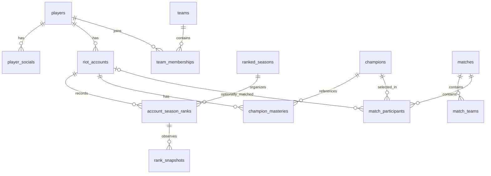
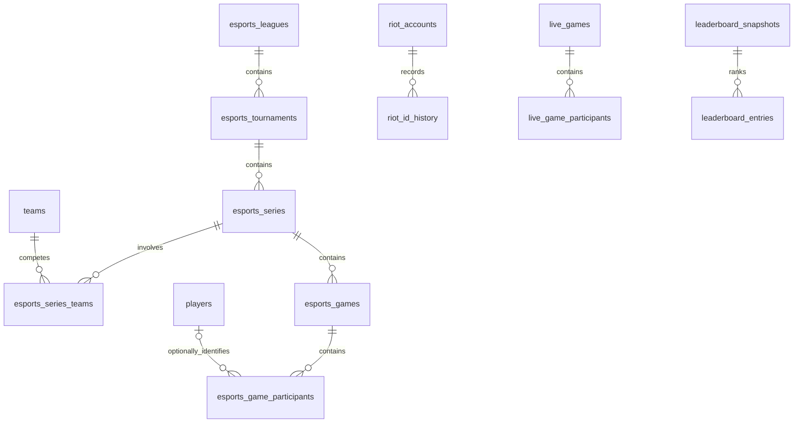

# LoLApp — PostgreSQL Schema, Data Relationships & Data Flow

> **Reference:** [`backend/sql/schema.sql`](../backend/sql/schema.sql) (documented for PostgreSQL 15+). This guide describes the schema represented in the supplied source; it does not modify the database or execute migrations. Treat the SQL file as the authority for exact DDL.

## Scope and current architecture

LoLApp combines a locally maintained professional-player and Riot ranking database with a FastAPI application that also integrates PandaScore esports data. These are **different data paths**: a working PandaScore API endpoint does not necessarily mean the corresponding `esports_*` PostgreSQL tables are populated.

1. **Initial LOLPros import:** roughly 5,900+ player profiles collected as HTML/JSONL, imported into player identities, social links, Riot accounts and initial ranked data. The import does **not** populate professional team tables.
2. **Riot synchronization:** account identity and PUUID resolution, Solo Queue/Flex rank updates, current/peak observations and rank snapshots. Additional mastery, match and spectator tables exist in the schema; their presence does **not** establish that every associated ingestion pipeline is enabled.
3. **PandaScore integration (implemented at API level):** professional players/career details, teams/rosters, leagues, series, tournaments, standings and match endpoints. Results are retrieved through the PandaScore client with caching/rate limiting; selected catalogs are also stored as JSON files under `backend/data/`.
4. **Team catalog:** the 2026 EMEA discovery gathered **166 distinct teams across 37 selected league IDs**. The broader PandaScore league metadata catalog contains **136 leagues**. These are discovery snapshots, not assertions that the relational `teams` or `esports_*` tables have been fully populated.
5. **Identity model:** `players.id` identifies the player; `riot_accounts.id` identifies a linked account row; `riot_accounts.puuid` identifies the Riot account across Riot API data. Do not rely on `lolpros_id` as the player key.

### Project layout (relevant paths)

```text
lol-data/
├── backend/
│   ├── api/              # FastAPI routers, schemas, services, repositories, tests
│   ├── sql/              # PostgreSQL DDL
│   ├── scripts/          # Data collection and discovery utilities
│   ├── data/             # Local PandaScore/EMEA catalogs
│   └── requirements.txt
├── docs/                 # Technical documentation
├── Dockerfile
└── compose.yaml
```

## All 25 tables

| Table | Purpose | Source / status |
|---|---|---|
| `players` | Professional player profiles, separate from their Riot accounts. | LOLPros HTML import |
| `player_socials` | Public social profiles associated with a player. | LOLPros HTML import |
| `riot_accounts` | Riot account identities for each player; one player may have multiple accounts. | LOLPros import; Riot Account/Summoner API |
| `ranked_seasons` | Yearly ranked seasons and their lifecycle. | Manual administration |
| `account_season_ranks` | Current and peak rank for each account, season and queue type. | Initial HTML import; Riot League-V4 |
| `rank_snapshots` | Timestamped rank observations used for LP progression. | Riot League-V4 |
| `matches` | Riot Match-V5 game records for Solo Queue/Flex (not PandaScore esports matches). | Riot Match-V5 |
| `champions` | Champion reference catalog for match and mastery relations. | Riot Data Dragon |
| `match_teams` | Team-side data and objectives within Riot Match-V5 matches. | Riot Match-V5 |
| `match_participants` | Participants, identities, champion picks and per-player match statistics. | Riot Match-V5 |
| `account_sync_state` | Per-account synchronization state, retries and timestamps. | Internal sync service |
| `teams` | Professional team entities in the relational schema. | External esports source / planned relational ingestion |
| `team_memberships` | Player–team roster history, including join and departure dates. | External esports source / planned relational ingestion |
| `champion_masteries` | Latest observed champion mastery for accounts. | Riot Champion Mastery-V4 |
| `riot_id_history` | Internal historical account names; not for public exposure. | Changes detected by Riot Account-V1 sync |
| `live_games` | Short-lived cache of Riot spectator live game records. | Riot Spectator-V5 |
| `live_game_participants` | Participants and selections in a live Riot game. | Riot Spectator-V5 |
| `leaderboard_snapshots` | Historical leaderboard snapshots for tracked pro accounts. | Locally tracked ranks |
| `leaderboard_entries` | Ranked account entries within each leaderboard snapshot. | Locally tracked ranks |
| `esports_leagues` | Relational esports league entities (distinct from the PandaScore JSON catalog). | External esports source / planned relational ingestion |
| `esports_tournaments` | Relational esports competitions organized by league and season. | External esports source / planned relational ingestion |
| `esports_series` | Best-of professional match series in the relational schema. | External esports source / planned relational ingestion |
| `esports_series_teams` | Competing teams and game totals in an esports series. | External esports source / planned relational ingestion |
| `esports_games` | Individual professional games associated with an esports series. | External esports source / planned relational ingestion |
| `esports_game_participants` | Individual professional-game participant statistics. | External esports source / planned relational ingestion |

## Principal relationships

| Parent | Cardinality | Child | Key / association |
|---|---|---|---|
| `players` | 1:N | `player_socials` | player_socials.player_id → players.id |
| `players` | 1:N | `riot_accounts` | riot_accounts.player_id → players.id |
| `riot_accounts` | 1:N | `account_season_ranks` | account_id |
| `ranked_seasons` | 1:N | `account_season_ranks` | season_id |
| `account_season_ranks` | 1:N | `rank_snapshots` | account_season_rank_id |
| `matches` | 1:N | `match_teams` | match_id |
| `match_teams` | 1:N | `match_participants` | composite (match_id, team_id) |
| `riot_accounts` | 0..1 per participant | `match_participants` | optional account_id / PUUID matching |
| `champions` | 1:N | `match_participants` | champion_id |
| `riot_accounts` | 1:N | `champion_masteries` | account_id |
| `champions` | 1:N | `champion_masteries` | champion_id |
| `players` | N:M | `teams` | via team_memberships |
| `riot_accounts` | 1:0..1 | `account_sync_state` | account_id PK/FK |
| `riot_accounts` | 1:N | `riot_id_history` | account_id |
| `live_games` | 1:N | `live_game_participants` | live_game_id |
| `ranked_seasons` | 1:N | `leaderboard_snapshots` | season_id |
| `leaderboard_snapshots` | 1:N | `leaderboard_entries` | snapshot_id |
| `esports_leagues` | 1:N | `esports_tournaments` | league_id |
| `esports_tournaments` | 1:N | `esports_series` | tournament_id |
| `esports_series` | 1:N | `esports_games` | series_id |
| `esports_series` | 1:N | `esports_series_teams` | series_id |
| `esports_games` | 1:N | `esports_game_participants` | esports_game_id |

### Player with two Riot accounts

```text
players [id=1, nickname=Kaori]
├── riot_accounts [id=101, player_id=1, puuid=...]
│   ├── account_season_ranks [account_id=101, season_id=S16]
│   │   └── rank_snapshots [time-stamped LP observations]
│   ├── champion_masteries [by champion]
│   └── match_participants [via account_id / PUUID]
└── riot_accounts [id=102, player_id=1, puuid=...]
    └── account_season_ranks [account_id=102, season_id=S16]
```

An identified Riot Match-V5 participant may be linked to a professional player via `match_participants.puuid → riot_accounts.puuid → players.id`. Unmatched PUUIDs should not be presented as identified professional players.

## Ranked seasons, current rank, peak rank and snapshots

- Exactly one ranked season should have `ranked_seasons.status = ACTIVE`; season rollover is an administrative operation.
- `account_season_ranks` has a unique record per `(account_id, season_id, queue_type)`.
- Initial HTML import may populate current/peak values for selected accounts only; missing rank information remains `NULL`.
- Riot League-V4 updates current rank. The documented `trg_account_rank_peak` trigger preserves the highest observed peak when applicable; verify its exact comparison logic in `schema.sql`.
- When S16 is finalized, set `finalized_at`; start new S17 rows rather than overwriting or copying old S16 rank history.
- `rank_snapshots` records sampled observations, **not** authoritative per-match LP deltas. Riot Match-V5 does not provide a reliable historical LP delta for every game.
- `RANKED_SOLO_5x5` and `RANKED_FLEX_SR` are separate queue types.

## Data ingestion and implementation boundaries

| Component | Main database targets or output | Notes |
|---|---|---|
| LOLPros HTML → JSONL importer | `players`, `player_socials`, `riot_accounts`, initial `account_season_ranks` and `rank_snapshots` | One-time/import-on-demand ingestion. |
| `lolapp_riot_sync.py --sections accounts,ranks` | `riot_accounts`, `riot_id_history`, `account_sync_state`, `account_season_ranks`, `rank_snapshots` | Active sync sections in the project workflow. |
| Optional `mastery` sync | `champions`, `champion_masteries`, `account_sync_state` | Schema/pipeline description; verify enabled CLI paths. |
| Optional `matches` sync | `matches`, `match_teams`, `match_participants`, `champions`, `account_sync_state` | Riot SoloQ/Flex match history, distinct from pro esports matches. |
| Optional `live` sync | `live_games`, `live_game_participants`, `champions`, `account_sync_state` | Riot spectator data, not professional esports streams. |
| Leaderboard snapshot job | `leaderboard_snapshots`, `leaderboard_entries` | Tracked pro accounts only. |
| PandaScore FastAPI client | API responses and cached results | Professional teams/leagues/series/tournaments/matches, not automatically SQL records. |
| EMEA discovery scripts | `backend/data/emea_teams_2026.json` plus progress files | 166 unique team IDs across 37 selected EMEA leagues in recorded snapshot. |
| PandaScore league inspection | `backend/data/pandascore_lol_leagues.json` | 136 metadata records in recorded catalog. |
| Future relational esports importer | `teams`, `team_memberships`, `esports_*` | Do not imply these tables are populated by the current PandaScore API client. |

## Entity relationship diagrams

### Player identities, ranked history and Riot games



### Relational esports model and supporting history



> **Naming warning:** PandaScore calls a league period a **series**, and its matches may be best-of contests. The relational schema above names a best-of contest `esports_series` under `esports_tournaments`. These are not automatically one-to-one; mapping requires an explicit ingestion design.

## Complete table column reference

The following definitions are transcribed from the supplied documentation, rather than independently verified against a live database. Three visibly corrupted source lines are flagged instead of silently repaired.

### 1. `players`

Professional player profiles, separate from their Riot accounts.

**Source:** LOLPros HTML import.

| Column | PostgreSQL definition |
|---|---|
| `id` | `BIGINT GENERATED ALWAYS AS IDENTITY PRIMARY KEY` |
| `nickname` | `VARCHAR(100) NOT NULL` |
| `slug` | `VARCHAR(150) NOT NULL UNIQUE` |
| `country_code` | `CHAR(2)` |
| `main_role` | `VARCHAR(16)` |
| `profile_image_url` | `TEXT` |
| `created_at` | `TIMESTAMPTZ NOT NULL DEFAULT now()` |
| `updated_at` | `TIMESTAMPTZ NOT NULL DEFAULT now()` |

**Table constraints / additional keys:**

- `CONSTRAINT players_role_ck CHECK (main_role IS NULL OR main_role IN ('TOP','JUNGLE','MIDDLE','BOTTOM','UTILITY'))`

### 2. `player_socials`

Public social profiles associated with a player.

**Source:** LOLPros HTML import.

| Column | PostgreSQL definition |
|---|---|
| `id` | `BIGINT GENERATED ALWAYS AS IDENTITY PRIMARY KEY` |
| `player_id` | `BIGINT NOT NULL REFERENCES players(id) ON DELETE CASCADE` |
| `platform` | `VARCHAR(40) NOT NULL` |
| `url` | `TEXT NOT NULL` |

**Table constraints / additional keys:**

- `UNIQUE (player_id, platform, url)`

### 3. `riot_accounts`

Riot account identities for each player; one player may have multiple accounts.

**Source:** LOLPros import; Riot Account/Summoner API.

| Column | PostgreSQL definition |
|---|---|
| `id` | `BIGINT GENERATED ALWAYS AS IDENTITY PRIMARY KEY` |
| `player_id` | `BIGINT NOT NULL REFERENCES players(id) ON DELETE RESTRICT` |
| `puuid` | `VARCHAR(128) UNIQUE` |
| `game_name` | `VARCHAR(100) NOT NULL` |
| `tag_line` | `VARCHAR(32) NOT NULL` |
| `platform_id` | `VARCHAR(12)` |
| `profile_icon_id` | `INTEGER` |
| `last_synced_at` | `TIMESTAMPTZ` |
| `created_at` | `TIMESTAMPTZ NOT NULL DEFAULT now()` |

> **Source quality note:** The original document contains corrupted fragments near the `riot_accounts` constraints (`TR1`, `KR etc.; nullable before resolution...`). Check `backend/sql/schema.sql` for the actual `platform_id` and `summoner_level` definitions before treating those fragments as DDL.

### 4. `ranked_seasons`

Yearly ranked seasons and their lifecycle.

**Source:** Manual administration.

| Column | PostgreSQL definition |
|---|---|
| `id` | `INTEGER GENERATED ALWAYS AS IDENTITY PRIMARY KEY` |
| `season_year` | `SMALLINT NOT NULL UNIQUE` |
| `label` | `VARCHAR(20) NOT NULL UNIQUE` |
| `starts_at` | `TIMESTAMPTZ NOT NULL` |
| `ends_at` | `TIMESTAMPTZ NOT NULL` |
| `status` | `VARCHAR(12) NOT NULL DEFAULT 'UPCOMING'` |

**Table constraints / additional keys:**

- `CHECK (ends_at > starts_at)`
- `CHECK (status IN ('UPCOMING','ACTIVE','FINISHED'))`

### 5. `account_season_ranks`

Current and peak rank for each account, season and queue type.

**Source:** Initial HTML import; Riot League-V4.

| Column | PostgreSQL definition |
|---|---|
| `id` | `BIGINT GENERATED ALWAYS AS IDENTITY PRIMARY KEY` |
| `account_id` | `BIGINT NOT NULL REFERENCES riot_accounts(id) ON DELETE CASCADE` |
| `season_id` | `INTEGER NOT NULL REFERENCES ranked_seasons(id)` |
| `queue_type` | `VARCHAR(32) NOT NULL` |
| `current_tier` | `VARCHAR(16)` |
| `current_division` | `VARCHAR(3)` |
| `current_lp` | `INTEGER CHECK (current_lp IS NULL OR current_lp >= 0)` |
| `current_wins` | `INTEGER CHECK (current_wins IS NULL OR current_wins >= 0)` |
| `current_losses` | `INTEGER CHECK (current_losses IS NULL OR current_losses >= 0)` |
| `current_observed_at` | `TIMESTAMPTZ` |
| `peak_tier` | `VARCHAR(16)` |
| `peak_division` | `VARCHAR(3)` |
| `peak_lp` | `INTEGER CHECK (peak_lp IS NULL OR peak_lp >= 0)` |
| `peak_observed_at` | `TIMESTAMPTZ` |
| `finalized_at` | `TIMESTAMPTZ` |

**Table constraints / additional keys:**

- `UNIQUE (account_id, season_id, queue_type)`
- `CHECK (queue_type IN ('RANKED_SOLO_5x5','RANKED_FLEX_SR'))`
- `CHECK (current_division IS NULL OR current_division IN ('I','II','III','IV'))`
- `CHECK (peak_division IS NULL OR peak_division IN ('I','II','III','IV'))`
- `CHECK (finalized_at IS NULL OR current_observed_at IS NOT NULL)`

### 6. `rank_snapshots`

Timestamped rank observations used for LP progression.

**Source:** Riot League-V4.

| Column | PostgreSQL definition |
|---|---|
| `id` | `BIGINT GENERATED ALWAYS AS IDENTITY PRIMARY KEY` |
| `account_season_rank_id` | `BIGINT NOT NULL REFERENCES account_season_ranks(id) ON DELETE CASCADE` |
| `tier` | `VARCHAR(16)` |
| `division` | `VARCHAR(3)` |
| `lp` | `INTEGER CHECK (lp IS NULL OR lp >= 0)` |
| `wins` | `INTEGER CHECK (wins IS NULL OR wins >= 0)` |
| `losses` | `INTEGER CHECK (losses IS NULL OR losses >= 0)` |
| `observed_at` | `TIMESTAMPTZ NOT NULL DEFAULT now()` |

**Table constraints / additional keys:**

- `UNIQUE (account_season_rank_id, observed_at)`
- `CHECK (division IS NULL OR division IN ('I','II','III','IV'))`

### 7. `matches`

Riot Match-V5 game records for Solo Queue/Flex (not PandaScore esports matches).

**Source:** Riot Match-V5.

| Column | PostgreSQL definition |
|---|---|
| `match_id` | `VARCHAR(80) PRIMARY KEY` |
| `queue_id` | `INTEGER NOT NULL` |
| `game_mode` | `VARCHAR(32)` |
| `map_id` | `INTEGER` |
| `game_version` | `VARCHAR(50)` |
| `started_at` | `TIMESTAMPTZ NOT NULL` |
| `duration_seconds` | `INTEGER CHECK (duration_seconds IS NULL OR duration_seconds >= 0)` |
| `raw_data` | `JSONB` |
| `fetched_at` | `TIMESTAMPTZ NOT NULL DEFAULT now()` |

> **Source quality note:** The source has a malformed line combining an example match ID and `platform_id` definition. Verify the actual `matches` columns and constraints in `backend/sql/schema.sql`.

### 8. `champions`

Champion reference catalog for match and mastery relations.

**Source:** Riot Data Dragon.

| Column | PostgreSQL definition |
|---|---|
| `id` | `INTEGER PRIMARY KEY` |
| `ddragon_key` | `VARCHAR(64) NOT NULL UNIQUE` |
| `name` | `VARCHAR(100) NOT NULL` |
| `image_filename` | `VARCHAR(150)` |
| `updated_at` | `TIMESTAMPTZ NOT NULL DEFAULT now()` |

### 9. `match_teams`

Team-side data and objectives within Riot Match-V5 matches.

**Source:** Riot Match-V5.

| Column | PostgreSQL definition |
|---|---|
| `match_id` | `VARCHAR(80) NOT NULL REFERENCES matches(match_id) ON DELETE CASCADE` |
| `team_id` | `INTEGER NOT NULL` |
| `win` | `BOOLEAN` |
| `champion_kills` | `INTEGER CHECK (champion_kills IS NULL OR champion_kills >= 0)` |
| `baron_kills` | `INTEGER CHECK (baron_kills IS NULL OR baron_kills >= 0)` |
| `dragon_kills` | `INTEGER CHECK (dragon_kills IS NULL OR dragon_kills >= 0)` |
| `tower_kills` | `INTEGER CHECK (tower_kills IS NULL OR tower_kills >= 0)` |
| `inhibitor_kills` | `INTEGER CHECK (inhibitor_kills IS NULL OR inhibitor_kills >= 0)` |
| `objectives_json` | `JSONB NOT NULL DEFAULT '{}'::jsonb` |
| `bans_json` | `JSONB NOT NULL DEFAULT '[]'::jsonb` |

**Table constraints / additional keys:**

- `PRIMARY KEY (match_id, team_id)`

### 10. `match_participants`

Participants, identities, champion picks and per-player match statistics.

**Source:** Riot Match-V5.

| Column | PostgreSQL definition |
|---|---|
| `match_id` | `VARCHAR(80) NOT NULL` |
| `participant_id` | `SMALLINT NOT NULL CHECK (participant_id > 0)` |
| `puuid` | `VARCHAR(128)` |
| `account_id` | `BIGINT REFERENCES riot_accounts(id) ON DELETE SET NULL` |
| `team_id` | `INTEGER NOT NULL` |
| `champion_id` | `INTEGER REFERENCES champions(id)` |
| `team_position` | `VARCHAR(20)` |
| `individual_position` | `VARCHAR(20)` |
| `win` | `BOOLEAN` |
| `kills` | `INTEGER CHECK (kills IS NULL OR kills >= 0)` |
| `deaths` | `INTEGER CHECK (deaths IS NULL OR deaths >= 0)` |
| `assists` | `INTEGER CHECK (assists IS NULL OR assists >= 0)` |
| `total_minions_killed` | `INTEGER` |
| `neutral_minions_killed` | `INTEGER` |
| `cs` | `INTEGER GENERATED ALWAYS AS (COALESCE(total_minions_killed,0)+COALESCE(neutral_minions_killed,0)) STORED` |
| `gold_earned` | `INTEGER` |
| `damage_to_champions` | `INTEGER` |
| `damage_taken` | `INTEGER` |
| `vision_score` | `INTEGER` |
| `wards_placed` | `INTEGER` |
| `wards_killed` | `INTEGER` |
| `spell1_id` | `INTEGER` |
| `spell2_id` | `INTEGER` |
| `items_json` | `JSONB NOT NULL DEFAULT '[]'::jsonb` |
| `perks_json` | `JSONB NOT NULL DEFAULT '{}'::jsonb` |
| `extra_stats` | `JSONB NOT NULL DEFAULT '{}'::jsonb` |

**Table constraints / additional keys:**

- `PRIMARY KEY (match_id, participant_id)`
- `FOREIGN KEY (match_id, team_id) REFERENCES match_teams(match_id, team_id) ON DELETE CASCADE`

### 11. `account_sync_state`

Per-account synchronization state, retries and timestamps.

**Source:** Internal sync service.

| Column | PostgreSQL definition |
|---|---|
| `account_id` | `BIGINT PRIMARY KEY REFERENCES riot_accounts(id) ON DELETE CASCADE` |
| `last_account_sync_at` | `TIMESTAMPTZ` |
| `last_rank_sync_at` | `TIMESTAMPTZ` |
| `last_mastery_sync_at` | `TIMESTAMPTZ` |
| `last_match_sync_at` | `TIMESTAMPTZ` |
| `last_live_check_at` | `TIMESTAMPTZ` |
| `oldest_match_synced_at` | `TIMESTAMPTZ` |
| `backfill_before_at` | `TIMESTAMPTZ` |
| `next_retry_at` | `TIMESTAMPTZ` |
| `sync_status` | `VARCHAR(16) NOT NULL DEFAULT 'PENDING'` |
| `last_error` | `TEXT` |
| `updated_at` | `TIMESTAMPTZ NOT NULL DEFAULT now()` |

**Table constraints / additional keys:**

- `CHECK (sync_status IN ('PENDING','RUNNING','OK','FAILED','PAUSED'))`

### 12. `teams`

Professional team entities in the relational schema.

**Source:** External esports source / planned relational ingestion.

| Column | PostgreSQL definition |
|---|---|
| `id` | `BIGINT GENERATED ALWAYS AS IDENTITY PRIMARY KEY` |
| `name` | `VARCHAR(160) NOT NULL` |
| `slug` | `VARCHAR(180) NOT NULL UNIQUE` |
| `short_name` | `VARCHAR(24)` |
| `region_code` | `VARCHAR(32)` |
| `logo_url` | `TEXT` |
| `created_at` | `TIMESTAMPTZ NOT NULL DEFAULT now()` |

### 13. `team_memberships`

Player–team roster history, including join and departure dates.

**Source:** External esports source / planned relational ingestion.

| Column | PostgreSQL definition |
|---|---|
| `id` | `BIGINT GENERATED ALWAYS AS IDENTITY PRIMARY KEY` |
| `player_id` | `BIGINT NOT NULL REFERENCES players(id) ON DELETE CASCADE` |
| `team_id` | `BIGINT NOT NULL REFERENCES teams(id) ON DELETE CASCADE` |
| `roster_role` | `VARCHAR(32) NOT NULL DEFAULT 'PLAYER'` |
| `game_position` | `VARCHAR(16)` |
| `joined_on` | `DATE` |
| `left_on` | `DATE` |
| `source_url` | `TEXT` |

**Table constraints / additional keys:**

- `CHECK (left_on IS NULL OR joined_on IS NULL OR left_on >= joined_on)`
- `CHECK (game_position IS NULL OR game_position IN ('TOP','JUNGLE','MIDDLE','BOTTOM','UTILITY'))`

### 14. `champion_masteries`

Latest observed champion mastery for accounts.

**Source:** Riot Champion Mastery-V4.

| Column | PostgreSQL definition |
|---|---|
| `account_id` | `BIGINT NOT NULL REFERENCES riot_accounts(id) ON DELETE CASCADE` |
| `champion_id` | `INTEGER NOT NULL REFERENCES champions(id)` |
| `mastery_level` | `INTEGER NOT NULL CHECK (mastery_level >= 0)` |
| `mastery_points` | `BIGINT NOT NULL CHECK (mastery_points >= 0)` |
| `points_since_last_level` | `INTEGER` |
| `points_until_next_level` | `INTEGER` |
| `marks_earned` | `INTEGER` |
| `last_play_at` | `TIMESTAMPTZ` |
| `observed_at` | `TIMESTAMPTZ NOT NULL DEFAULT now()` |
| `extra_data` | `JSONB NOT NULL DEFAULT '{}'::jsonb` |

**Table constraints / additional keys:**

- `PRIMARY KEY (account_id, champion_id)`

### 15. `riot_id_history`

Internal historical account names; not for public exposure.

**Source:** Changes detected by Riot Account-V1 sync.

| Column | PostgreSQL definition |
|---|---|
| `id` | `BIGINT GENERATED ALWAYS AS IDENTITY PRIMARY KEY` |
| `account_id` | `BIGINT NOT NULL REFERENCES riot_accounts(id) ON DELETE CASCADE` |
| `game_name` | `VARCHAR(100) NOT NULL` |
| `tag_line` | `VARCHAR(32) NOT NULL` |
| `first_seen_at` | `TIMESTAMPTZ NOT NULL` |
| `last_seen_at` | `TIMESTAMPTZ NOT NULL` |

**Table constraints / additional keys:**

- `CHECK (last_seen_at >= first_seen_at)`
- `UNIQUE (account_id, first_seen_at)`

### 16. `live_games`

Short-lived cache of Riot spectator live game records.

**Source:** Riot Spectator-V5.

| Column | PostgreSQL definition |
|---|---|
| `id` | `BIGINT GENERATED ALWAYS AS IDENTITY PRIMARY KEY` |
| `platform_id` | `VARCHAR(12) NOT NULL` |
| `riot_game_id` | `BIGINT NOT NULL` |
| `queue_id` | `INTEGER` |
| `game_mode` | `VARCHAR(32)` |
| `map_id` | `INTEGER` |
| `started_at` | `TIMESTAMPTZ` |
| `first_seen_at` | `TIMESTAMPTZ NOT NULL DEFAULT now()` |
| `last_seen_at` | `TIMESTAMPTZ NOT NULL DEFAULT now()` |
| `expires_at` | `TIMESTAMPTZ NOT NULL` |
| `ended_at` | `TIMESTAMPTZ` |
| `bans_json` | `JSONB NOT NULL DEFAULT '[]'::jsonb` |

**Table constraints / additional keys:**

- `UNIQUE (platform_id, riot_game_id)`
- `CHECK (last_seen_at >= first_seen_at)`

### 17. `live_game_participants`

Participants and selections in a live Riot game.

**Source:** Riot Spectator-V5.

| Column | PostgreSQL definition |
|---|---|
| `live_game_id` | `BIGINT NOT NULL REFERENCES live_games(id) ON DELETE CASCADE` |
| `slot` | `SMALLINT NOT NULL CHECK (slot > 0)` |
| `puuid` | `VARCHAR(128)` |
| `account_id` | `BIGINT REFERENCES riot_accounts(id) ON DELETE SET NULL` |
| `team_id` | `INTEGER NOT NULL` |
| `champion_id` | `INTEGER REFERENCES champions(id)` |
| `spell1_id` | `INTEGER` |
| `spell2_id` | `INTEGER` |
| `profile_icon_id` | `INTEGER` |
| `is_bot` | `BOOLEAN NOT NULL DEFAULT FALSE` |
| `perks_json` | `JSONB NOT NULL DEFAULT '{}'::jsonb` |

**Table constraints / additional keys:**

- `PRIMARY KEY (live_game_id, slot)`

### 18. `leaderboard_snapshots`

Historical leaderboard snapshots for tracked pro accounts.

**Source:** Locally tracked ranks.

| Column | PostgreSQL definition |
|---|---|
| `id` | `BIGINT GENERATED ALWAYS AS IDENTITY PRIMARY KEY` |
| `season_id` | `INTEGER NOT NULL REFERENCES ranked_seasons(id)` |
| `platform_id` | `VARCHAR(12) NOT NULL` |
| `queue_type` | `VARCHAR(32) NOT NULL` |
| `scope` | `VARCHAR(32) NOT NULL DEFAULT 'TRACKED_PROS'` |
| `captured_at` | `TIMESTAMPTZ NOT NULL DEFAULT now()` |

**Table constraints / additional keys:**

- `UNIQUE (season_id, platform_id, queue_type, scope, captured_at)`
- `CHECK (scope = 'TRACKED_PROS')`
- `CHECK (queue_type IN ('RANKED_SOLO_5x5','RANKED_FLEX_SR'))`

### 19. `leaderboard_entries`

Ranked account entries within each leaderboard snapshot.

**Source:** Locally tracked ranks.

| Column | PostgreSQL definition |
|---|---|
| `snapshot_id` | `BIGINT NOT NULL REFERENCES leaderboard_snapshots(id) ON DELETE CASCADE` |
| `rank_position` | `INTEGER NOT NULL CHECK (rank_position > 0)` |
| `account_id` | `BIGINT NOT NULL REFERENCES riot_accounts(id)` |
| `tier` | `VARCHAR(16) NOT NULL` |
| `division` | `VARCHAR(3)` |
| `lp` | `INTEGER NOT NULL CHECK (lp >= 0)` |
| `wins` | `INTEGER` |
| `losses` | `INTEGER` |

**Table constraints / additional keys:**

- `PRIMARY KEY (snapshot_id, rank_position)`
- `UNIQUE (snapshot_id, account_id)`

### 20. `esports_leagues`

Relational esports league entities (distinct from the PandaScore JSON catalog).

**Source:** External esports source / planned relational ingestion.

| Column | PostgreSQL definition |
|---|---|
| `id` | `BIGINT GENERATED ALWAYS AS IDENTITY PRIMARY KEY` |
| `name` | `VARCHAR(160) NOT NULL` |
| `slug` | `VARCHAR(180) NOT NULL UNIQUE` |
| `region_code` | `VARCHAR(32)` |
| `logo_url` | `TEXT` |

### 21. `esports_tournaments`

Relational esports competitions organized by league and season.

**Source:** External esports source / planned relational ingestion.

| Column | PostgreSQL definition |
|---|---|
| `id` | `BIGINT GENERATED ALWAYS AS IDENTITY PRIMARY KEY` |
| `league_id` | `BIGINT NOT NULL REFERENCES esports_leagues(id)` |
| `name` | `VARCHAR(180) NOT NULL` |
| `slug` | `VARCHAR(220) NOT NULL UNIQUE` |
| `season_year` | `SMALLINT NOT NULL` |
| `split_name` | `VARCHAR(80)` |
| `starts_at` | `TIMESTAMPTZ` |
| `ends_at` | `TIMESTAMPTZ` |

**Table constraints / additional keys:**

- `CHECK (ends_at IS NULL OR starts_at IS NULL OR ends_at >= starts_at)`

### 22. `esports_series`

Best-of professional match series in the relational schema.

**Source:** External esports source / planned relational ingestion.

| Column | PostgreSQL definition |
|---|---|
| `id` | `BIGINT GENERATED ALWAYS AS IDENTITY PRIMARY KEY` |
| `tournament_id` | `BIGINT NOT NULL REFERENCES esports_tournaments(id)` |
| `source_name` | `VARCHAR(80)` |
| `external_series_id` | `VARCHAR(150)` |
| `round_label` | `VARCHAR(100)` |
| `best_of` | `SMALLINT CHECK (best_of IS NULL OR best_of IN (1,3,5,7))` |
| `status` | `VARCHAR(16) NOT NULL DEFAULT 'SCHEDULED'` |
| `scheduled_at` | `TIMESTAMPTZ` |
| `started_at` | `TIMESTAMPTZ` |
| `finished_at` | `TIMESTAMPTZ` |
| `source_url` | `TEXT` |

**Table constraints / additional keys:**

- `UNIQUE (source_name, external_series_id)`
- `CHECK (status IN ('SCHEDULED','LIVE','FINISHED','CANCELLED'))`

### 23. `esports_series_teams`

Competing teams and game totals in an esports series.

**Source:** External esports source / planned relational ingestion.

| Column | PostgreSQL definition |
|---|---|
| `series_id` | `BIGINT NOT NULL REFERENCES esports_series(id) ON DELETE CASCADE` |
| `slot` | `SMALLINT NOT NULL CHECK (slot IN (1,2))` |
| `team_id` | `BIGINT NOT NULL REFERENCES teams(id)` |
| `games_won` | `SMALLINT NOT NULL DEFAULT 0 CHECK (games_won >= 0)` |

**Table constraints / additional keys:**

- `PRIMARY KEY (series_id, slot)`
- `UNIQUE (series_id, team_id)`

### 24. `esports_games`

Individual professional games associated with an esports series.

**Source:** External esports source / planned relational ingestion.

| Column | PostgreSQL definition |
|---|---|
| `id` | `BIGINT GENERATED ALWAYS AS IDENTITY PRIMARY KEY` |
| `series_id` | `BIGINT NOT NULL REFERENCES esports_series(id) ON DELETE CASCADE` |
| `game_number` | `SMALLINT NOT NULL CHECK (game_number > 0)` |
| `blue_team_id` | `BIGINT REFERENCES teams(id)` |
| `red_team_id` | `BIGINT REFERENCES teams(id)` |
| `winner_team_id` | `BIGINT REFERENCES teams(id)` |
| `riot_match_id` | `VARCHAR(80) UNIQUE REFERENCES matches(match_id)` |
| `patch` | `VARCHAR(40)` |
| `started_at` | `TIMESTAMPTZ` |
| `duration_seconds` | `INTEGER` |
| `draft_json` | `JSONB NOT NULL DEFAULT '{}'::jsonb` |
| `source_name` | `VARCHAR(80)` |
| `external_game_id` | `VARCHAR(150)` |
| `extra_data` | `JSONB NOT NULL DEFAULT '{}'::jsonb` |

**Table constraints / additional keys:**

- `UNIQUE (series_id, game_number)`
- `UNIQUE (source_name, external_game_id)`
- `FOREIGN KEY (series_id, blue_team_id) REFERENCES esports_series_teams(series_id, team_id)`
- `FOREIGN KEY (series_id, red_team_id) REFERENCES esports_series_teams(series_id, team_id)`
- `CHECK (blue_team_id IS NULL OR red_team_id IS NULL OR blue_team_id <> red_team_id)`
- `CHECK (winner_team_id IS NULL OR winner_team_id IN (blue_team_id, red_team_id))`
- `CHECK (duration_seconds IS NULL OR duration_seconds >= 0)`

### 25. `esports_game_participants`

Individual professional-game participant statistics.

**Source:** External esports source / planned relational ingestion.

| Column | PostgreSQL definition |
|---|---|
| `esports_game_id` | `BIGINT NOT NULL REFERENCES esports_games(id) ON DELETE CASCADE` |
| `slot` | `SMALLINT NOT NULL CHECK (slot BETWEEN 1 AND 20)` |
| `team_id` | `BIGINT NOT NULL REFERENCES teams(id)` |
| `player_id` | `BIGINT REFERENCES players(id) ON DELETE SET NULL` |
| `player_name_snapshot` | `VARCHAR(100)` |
| `game_position` | `VARCHAR(16)` |
| `kills` | `INTEGER` |
| `deaths` | `INTEGER` |
| `assists` | `INTEGER` |
| `cs` | `INTEGER` |
| `gold_earned` | `INTEGER` |
| `damage_to_champions` | `INTEGER` |
| `vision_score` | `INTEGER` |
| `extra_stats` | `JSONB NOT NULL DEFAULT '{}'::jsonb` |

> **Source quality note:** The original `champion_id` row was corrupted by stray text. Its intended definition appears to reference `champions(id)`, but consult the SQL schema for the exact column.

**Table constraints / additional keys:**

- `PRIMARY KEY (esports_game_id, slot)`
- `CHECK (game_position IS NULL OR game_position IN ('TOP','JUNGLE','MIDDLE','BOTTOM','UTILITY'))`

## Example inspection queries

```sql
-- Players and their linked Riot accounts
SELECT p.nickname, a.id AS account_id, a.game_name, a.tag_line, a.platform_id
FROM players p
LEFT JOIN riot_accounts a ON a.player_id = p.id
ORDER BY p.id;

-- Current/peak rank per account, season and queue
SELECT p.nickname, a.game_name, s.label, r.queue_type,
       r.current_tier, r.current_lp, r.peak_tier, r.peak_lp, r.finalized_at
FROM account_season_ranks r
JOIN ranked_seasons s ON s.id = r.season_id
JOIN riot_accounts a ON a.id = r.account_id
JOIN players p ON p.id = a.player_id
ORDER BY p.nickname, s.season_year DESC;

-- Match participants with optional professional-player profile resolution
SELECT mp.match_id, mp.team_id, mp.champion_id, mp.kills, mp.deaths, mp.assists,
       p.nickname AS pro_player, p.slug AS profile_slug
FROM match_participants mp
LEFT JOIN riot_accounts a ON a.puuid = mp.puuid
LEFT JOIN players p ON p.id = a.player_id
WHERE mp.match_id = 'EUW1_1234567890';
```

## Operational and security notes

- Keep `.env`, Riot API tokens, PandaScore API keys and DB credentials out of Git; provide safe `.env.example` keys only.
- `riot_id_history` is for internal identity tracking. Do not expose historical Riot IDs in public player profiles.
- `champion_masteries` stores the latest observation; temporal mastery progression needs its own snapshots.
- `match_participants.extra_stats` may retain additional Riot Match-V5 fields as JSONB.
- Riot Solo Queue/Flex matches, Riot spectator live games and professional esports matches are distinct concepts.
- Use `backend/api/routers/` and `backend/api/schemas/` to verify actual public API contracts. Not every table is reachable through HTTP.
- Team Solo Queue rankings use a custom tier-aware/LP-based heuristic with ranked-roster coverage requirements; these are **not official Riot or tournament power rankings**.
- PandaScore data is subject to rate limits and missing fields. Avoid fetching all historical league/team matches merely to fulfill small paginated frontend requests.
- After moving code into `backend/`, run Uvicorn and pytest from that directory; Docker Compose can remain at repository root.
- For a definitive list of database indexes, triggers, constraints and table creation statements, use `backend/sql/schema.sql`; this document is a human-readable reference only.

## Verification checklist

- [ ] Compare table columns and constraints with the current `backend/sql/schema.sql` (particularly the three flagged malformed source fragments).
- [ ] Verify the unique ACTIVE season and `trg_account_rank_peak` behavior in the database.
- [ ] Confirm which optional sync sections are actually enabled before declaring their tables populated.
- [ ] Keep PandaScore API data, local JSON catalogs and SQL ingestion status separately documented.
- [ ] Verify health endpoint, API routes and test suite after deployment changes.
